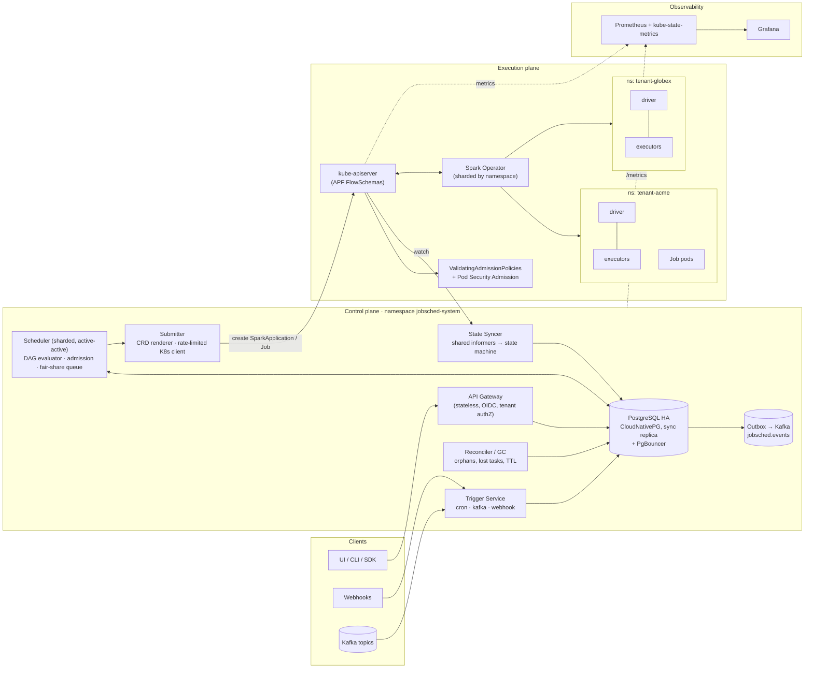
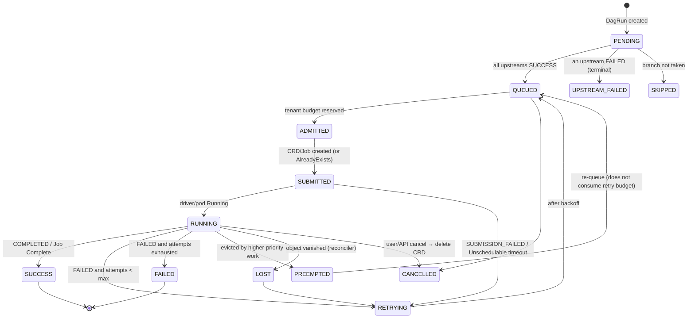
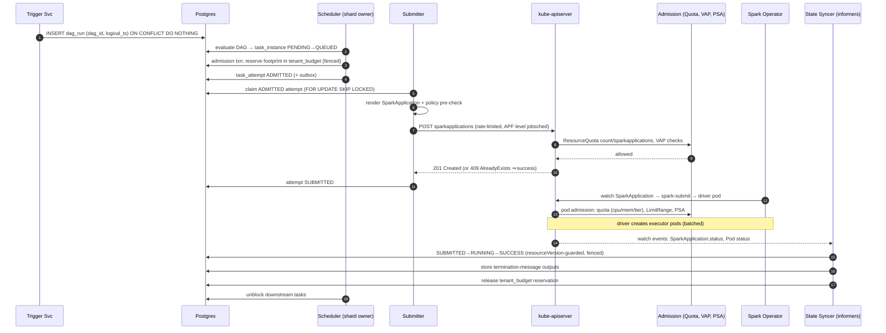

# Multi-Tenant Kubernetes-Native DAG Scheduler — Architecture

> Status: Design v1 · Scope: one Kubernetes cluster ("cell"), plus a path to many cells
> Workloads: Apache Spark (via Spark Operator `SparkApplication`) and generic containers (`batch/v1 Job`)

---

## 0. Design principles

1. **The metadata DB is the source of truth for *intent*** (what should run, and the state it is in).
   **Kubernetes is the source of truth for *reality*** (what is actually running). A reconciler keeps the two in step.
2. **Every side effect is idempotent.** Triggers, DB writes and Kubernetes object creation all carry
   keys that are deterministic. A duplicate attempt collides on a unique constraint or gets `AlreadyExists`; it
   never runs a second copy.
3. **Defense in depth for tenancy.** Each layer is enforced on its own: the scheduler checks first, and if it has a
   bug the cluster still enforces the same rules (ResourceQuota, admission policy, RBAC, NetworkPolicy).
   A compromised control plane cannot run privileged pods, read tenant secrets, or exceed a tenant's quota.
4. **Watch, don't poll.** All Kubernetes state comes from shared informers with label selectors. The control plane
   never runs a periodic `LIST`.
5. **Fail static.** If the DB or the control plane goes down, running workloads keep running. Only new dispatch stops.

---

## 1. High-level architecture



### 1.1 Control-plane components

All components ship as one Go binary, run in different modes (`--mode=api|trigger|scheduler|submitter|syncer`).
Each mode is its own Deployment so it can scale and fail on its own.

| Component | Responsibility | Scaling / HA model |
|---|---|---|
| **API Gateway** | CRUD for DAGs (versioned, immutable once published), manual triggers, run inspection, logs proxy, task output callback. AuthN uses OIDC. AuthZ maps `(user, group) → tenant role` and every query is filtered by `tenant_id`. | Stateless, HPA on RPS. ≥3 replicas across zones. |
| **Trigger Service** | **Cron**: evaluates schedules for its shards and inserts `dag_run` rows keyed by `(dag_id, logical_ts)`. **Kafka**: one consumer group, events filtered by CEL expression and mapped to DAG runs, idempotency key `topic/partition/offset` or the event ID. **Webhook**: HMAC-verified, requires an `Idempotency-Key` header. | Cron uses shard leases (§5). Kafka scales with partition assignment. Webhook handlers are stateless. |
| **Scheduler** | For each owned shard: evaluate DAG readiness, resolve upstream outputs into templates, run **tenant admission** (quota ledger, concurrency, fair share), and emit `ADMITTED` task attempts. Also runs within-tenant preemption (§4.4). | Active-active over 256 virtual shards held through fenced leases. |
| **Submitter** | Render the `SparkApplication` or `Job` and validate it locally against the same policy the cluster enforces. Then create it with a client-side token-bucket limiter, a per-tenant fair queue, and handling for 429/`Retry-After`. | Stateless worker pool. Claims attempts with `FOR UPDATE SKIP LOCKED`. |
| **State Syncer** | Shared informers on `SparkApplication`, `Job` and `Pod`, filtered by label `jobsched.io/managed=true` and by shard group. Translates K8s states into scheduler states and writes them to the DB, guarded by `resourceVersion` and epoch. Reads task outputs from pod termination messages. | Each scheduler replica runs syncers for its own shard groups. |
| **Reconciler / GC** | Diffs DB in-flight attempts against the informer cache, never against a live LIST. Marks attempts `LOST` when their object is missing, deletes orphaned objects that have no DB row, expires stuck states, and enforces TTLs. | Runs inside the scheduler for each shard. |
| **Metadata DB** | PostgreSQL 16 on CloudNativePG: 3 instances, `synchronous_commit=on` with a quorum of 1 sync standby, PgBouncer in transaction mode. High-churn tables are partitioned by month. | Automated failover. RPO≈0, RTO<30s. |
| **Outbox** | Every state transition is written to `outbox` in the same transaction. Debezium or a relay publishes it to `jobsched.events` for UIs, alerting and downstream DAG triggers. | Exactly-once into Kafka through an idempotent producer plus outbox ID. |

### 1.2 Execution-plane components

| Component | Notes |
|---|---|
| **kube-apiserver** | Protected by dedicated API Priority & Fairness levels for the scheduler, the Spark Operator, and Spark drivers (per namespace). See §6 and `deploy/cluster/apf.yaml`. |
| **Spark Operator** (Kubeflow `spark-operator` v2) | One cluster-wide install for each *operator shard*. Each shard watches a disjoint set of tenant namespaces (`spark.jobNamespaces`) so its reconcile throughput scales horizontally. Configured with `controller.workers=30` and its own APF level. **The operator's mutating webhook is required.** It is what applies `priorityClassName`, security contexts, env, secret volumes, tolerations and GPUs to driver and executor pods. Without it, the tier-ceiling policy and PSA reject every Spark pod. Run it with ≥3 replicas and `failurePolicy: Fail`. |
| **Tenant namespaces** | One namespace per tenant per environment (`tenant-<name>`, or `tenant-<name>-<env>` for prod/non-prod split). Each one is created only by the **Tenant Operator** from a `Tenant` resource (or by GitOps). Each gets the full guardrail bundle: quota, limits, RBAC, NetworkPolicy, PSA labels. |
| **Gang scheduler (optional)** | Apache YuniKorn or Volcano (`spec.batchScheduler`) for all-or-nothing placement of driver plus minimum executors on clusters with heavy overcommit. The scheduler's own footprint ledger (§4.2) already prevents quota deadlock, so this is an optimisation, not a requirement. |

### 1.3 Domain model

```
Tenant ─┬─ Namespace(s) (1..n, per env)
        ├─ TenantBudget (mirrors ResourceQuota.hard + scheduler-side ledger)
        └─ Dag ── DagVersion (immutable spec) ── DagRun (logical_ts, trigger) ── TaskInstance ── TaskAttempt
                                                                                     └─ TaskOutput (small k/v, ≤ 64 KiB)
```

The full DDL is in [`schema/metadata.sql`](../schema/metadata.sql) and an example DAG is in [`examples/dag.yaml`](../examples/dag.yaml).

### 1.4 Task state machine



`QUEUED`, `RUNNING`, `SUCCESS`, `FAILED` and `RETRYING` are the states users see. `ADMITTED`, `SUBMITTED`,
`PREEMPTED` and `LOST` are internal states that make crash recovery exact.

**Retries are owned by the scheduler only.** Every rendered `SparkApplication` uses `restartPolicy: Never`, and
every `Job` uses `backoffLimit: 0`. Each attempt is a new object with a deterministic name, so there is one retry
counter and one audit trail.

Spark Operator → scheduler state mapping:

| `SparkApplication.status.applicationState.state` | Scheduler state |
|---|---|
| `""`, `SUBMITTED`, `PENDING_RERUN` | `SUBMITTED` |
| `RUNNING`, `SUCCEEDING`, `FAILING` | `RUNNING` |
| `COMPLETED` | `SUCCESS` |
| `FAILED`, `SUBMISSION_FAILED` | `RETRYING` or `FAILED` (by attempt budget) |
| `UNKNOWN`, `INVALIDATING` | no transition; the reconciler escalates if this lasts longer than 10 min |

For `Job`: the `Complete` condition maps to `SUCCESS`, `Failed` maps to `RETRYING`/`FAILED`, and a `DisruptionTarget`
condition or eviction reason maps to `PREEMPTED`.

### 1.5 Passing state between tasks

| Size | Mechanism | Why |
|---|---|---|
| ≤ 4 KiB | The task writes JSON to `/dev/termination-log`. The syncer reads `pod.status.containerStatuses[].state.terminated.message` from the informer cache and stores it in `task_output`. | No extra network path or credentials, and it arrives in the same watch event that carries completion. |
| ≤ 64 KiB | `POST /v1/attempts/{id}/outputs` to the API, authenticated with a **projected ServiceAccount token** (`audience: jobsched-api`, 10 min TTL). The API runs `TokenReview` and checks that the token's namespace and pod match the attempt. | A task can publish outputs only for itself. |
| Larger | Object storage URI under the tenant's own prefix (`s3://lake-acme/...`). Only the URI goes through the scheduler. | The scheduler never holds tenant data. |

Downstream tasks consume outputs through templating in the DAG spec (`{{ tasks.ingest.outputs.row_count }}`).
The values are injected as Spark `arguments`/`sparkConf`, or as container args and env.
They are **never** placed in Secrets, so the control plane needs no Secret permissions.

---

## 2. Multi-tenancy & isolation strategy

### 2.1 Boundary model

```
┌────────────────────────── Cluster ───────────────────────────────────┐
│ jobsched-system   (control plane: API, scheduler, syncer, DB)        │
│ spark-operator    (operator shards, webhook)                         │
│ monitoring        (Prometheus, kube-state-metrics, Grafana)          │
│                                                                      │
│ tenant-acme       ← Namespace = hard tenant boundary                 │
│   ├ ResourceQuota (overall) + ResourceQuota (per PriorityClass)      │
│   ├ LimitRange (defaults + max per container/pod)                    │
│   ├ SA spark-driver (pods/services/configmaps in own ns only)        │
│   ├ SA spark-executor / job-runner (no RBAC, no token automount)     │
│   ├ RoleBinding → jobsched-submitter  (control plane write path)     │
│   ├ RoleBinding → tenant-acme-developers (read-only for humans)      │
│   ├ NetworkPolicies: default-deny, DNS, intra-app, egress allowlist  │
│   └ PSA: enforce=restricted                                          │
│ tenant-globex     … identical bundle, different sizes                │
└──────────────────────────────────────────────────────────────────────┘
```

* **Namespace per tenant (per environment).** Namespaces are created only by the Tenant Operator
  (or Argo CD from a `tenants/` repo). Humans in a tenant cannot create namespaces, quotas or RBAC.
* **Optional node isolation** for regulated tenants: a dedicated node pool with taint `jobsched.io/tenant=acme:NoSchedule`.
  The submitter injects the matching toleration and node affinity, and a VAP rejects that toleration in any
  other namespace.
* **Secrets** are synced into the tenant namespace by External Secrets Operator from a tenant-scoped Vault path.
  The tenant's `SecretStore` can only read `secret/tenants/acme/*`. Specs refer to Secrets *by name*. The control
  plane has no `secrets` verbs anywhere.

### 2.2 How the control plane talks to tenant namespaces

Control-plane identities are split by privilege:

| ServiceAccount (`jobsched-system`) | Binding | Can do |
|---|---|---|
| `jobsched-submitter` | **RoleBinding in each tenant ns** to ClusterRole `jobsched-submitter` | create/delete/patch `sparkapplications`, `jobs`, `configmaps`, `networkpolicies` (strict mode); read pods/logs/events. **No secrets, no RBAC, no quotas.** |
| `jobsched-watcher` | ClusterRoleBinding to `jobsched-watcher` (read-only) | `get/list/watch` sparkapplications, jobs, pods, resourcequotas, events. One cluster-wide label-filtered watch per type instead of N per-namespace watches. |
| `jobsched-tenant-operator` | ClusterRole (privileged, separate Deployment, ideally replaced by GitOps) | Create and label `tenant-*` namespaces only. Write quotas, limitranges, ServiceAccounts, NetworkPolicies and RoleBindings only inside namespaces labelled `jobsched.io/tenant`. Bind only the approved platform ClusterRoles, and only via `bind`. It holds no pod or Secret permissions. Enforced by RBAC plus the `jobsched-tenant-operator-scope` VAP. |

Why the submitter uses a RoleBinding instead of a ClusterRoleBinding: if the submitter is compromised, it can only
write in namespaces that were onboarded explicitly. Even there, `ValidatingAdmissionPolicy` (§2.6) limits what it
can create.

Why the watcher has cluster scope: thousands of per-namespace watches would multiply apiserver watch caches and
connections. The trade-off is read access to pod specs cluster-wide. That is acceptable because a VAP forbids secret
values in env literals, and the watcher strips pod specs in a `SetTransform` before caching.

Impersonation (`Impersonate-User: system:serviceaccount:tenant-acme:jobsched-agent`) was considered and rejected
for the hot path. It needs the `impersonate` verb, which is very hard to scope safely, and it doubles authz cost on
every request. Attribution comes instead from per-shard userAgent, audit annotations, and the
`jobsched.io/requested-by` label.

### 2.3 ResourceQuota & LimitRange

Each tenant gets **two kinds of quota**:

1. **An overall quota** with hard ceilings on CPU, memory, GPU, ephemeral storage, PVCs, and object counts
   (pods, services, configmaps, `count/sparkapplications.sparkoperator.k8s.io`, `count/jobs.batch`). Object-count
   quotas protect etcd, not just compute.
2. **A quota per PriorityClass tier** (`scopeSelector: PriorityClass In [...]`). This caps how much *critical*
   capacity a tenant can use, so no tenant can label everything critical.

**Capacity contract:** the sum of all tenants' `critical` quotas is ≤ cluster capacity minus the system reserve,
so critical work is guaranteed. `standard` and `adhoc` are overcommitted (sum of quotas ≈ 1.5–2× capacity) and depend
on preemption.

The `LimitRange` sets defaults (no BestEffort pods, which would dodge memory accounting), sets maximums per container
and pod (one executor cannot take a whole node), and caps `maxLimitRequestRatio` (limits overcommit inside the tenant).

➡ Full YAML: [`deploy/tenants/tenant-acme/`](../deploy/tenants/tenant-acme/)

Excerpt:

```yaml
apiVersion: v1
kind: ResourceQuota
metadata: { name: compute, namespace: tenant-acme }
spec:
  hard:
    requests.cpu: "400"
    requests.memory: 1600Gi
    limits.memory: 1800Gi
    requests.nvidia.com/gpu: "8"
    requests.ephemeral-storage: 4Ti
    pods: "1500"
    services: "300"
    count/sparkapplications.sparkoperator.k8s.io: "500"
    count/jobs.batch: "1000"
---
apiVersion: v1
kind: ResourceQuota
metadata: { name: tier-critical, namespace: tenant-acme }
spec:
  hard: { requests.cpu: "120", requests.memory: 480Gi, requests.nvidia.com/gpu: "4" }
  scopeSelector:
    matchExpressions:
      - { scopeName: PriorityClass, operator: In,
          values: [jobsched-critical-driver, jobsched-critical-executor] }
```

### 2.4 RBAC

* **Humans** (`tenant-acme-developers` OIDC group) get **read-only** access to their namespace: pods, logs,
  sparkapplications, jobs, events. They cannot `create` SparkApplications directly. Every submission goes through
  the scheduler API, so DAG semantics, quotas and audit always apply. A break-glass `tenant-acme-admins` role adds
  `pods/exec` and `delete` and needs just-in-time elevation.
* **`spark-driver` SA** (in each tenant ns) is granted the platform ClusterRole `jobsched-spark-driver` through a
  RoleBinding, which limits it to its own namespace: pods, services, configmaps and PVCs that Spark needs to manage
  executors. It has no access to Secrets beyond what is mounted. Because this is a binding to a ClusterRole rather
  than a per-tenant Role, the Tenant Operator needs only `bind` on it, not those permissions cluster-wide.
* **`spark-executor` / `job-runner` SAs** have no Role and `automountServiceAccountToken: false`. Executors never
  talk to the apiserver.

➡ [`deploy/tenants/tenant-acme/rbac.yaml`](../deploy/tenants/tenant-acme/rbac.yaml) ·
[`deploy/control-plane/rbac.yaml`](../deploy/control-plane/rbac.yaml)

### 2.5 Network isolation

Baseline for each tenant namespace (all policies add up as allows on top of default-deny):

| Policy | Effect |
|---|---|
| `default-deny-all` | Deny all ingress and egress. |
| `allow-dns` | Egress to `kube-system/kube-dns` on 53/UDP and 53/TCP. |
| `allow-spark-intra-namespace` (standard mode) | Driver ↔ executor traffic (RPC 7078, block manager 7079, driver UI 4040), only between pods with `spark-role` in the **same namespace**. |
| `allow-driver-to-apiserver` | Drivers only: egress to the apiserver endpoints (`ipBlock`). |
| `allow-egress-data-plane` | Egress to the tenant's object store, Kafka and DB endpoints through an egress gateway or FQDN policy (Cilium `toFQDNs` when available). |
| `allow-jobsched-callbacks` | Egress to `jobsched-system/jobsched-api:8443` for output callbacks. |
| `allow-observability` | Ingress from `monitoring/prometheus` on 4040 (the `spark.ui.prometheus.enabled` servlet) and 8090 (optional JMX exporter), and from `jobsched-system/jobsched-api` (Spark UI proxy) on 4040. |

**Strict mode** (for regulated tenants, set with namespace label `jobsched.io/network-mode=strict`): the namespace-wide
intra-Spark allow is **not** installed. Instead the submitter creates a **per-attempt NetworkPolicy** that selects
`jobsched.io/attempt-id=<id>` for both ends, with an `ownerReference` to the SparkApplication so it is garbage-collected
along with it. Executors of app A then cannot reach the driver of app B, even inside the same tenant. A VAP restricts
submitter-created NetworkPolicies to this exact shape (§2.6).

➡ [`deploy/tenants/tenant-acme/networkpolicy.yaml`](../deploy/tenants/tenant-acme/networkpolicy.yaml) ·
[`examples/per-attempt-networkpolicy.yaml`](../examples/per-attempt-networkpolicy.yaml)

### 2.6 Admission guardrails (cluster-enforced)

* **Pod Security Admission**: `pod-security.kubernetes.io/enforce: restricted` on every tenant namespace.
* **ValidatingAdmissionPolicy (CEL, GA in 1.30)**, in [`deploy/cluster/admission-policies.yaml`](../deploy/cluster/admission-policies.yaml):
  * A `SparkApplication` in a tenant ns must use `serviceAccount: spark-driver`. Its PriorityClasses must be within
    the namespace's maximum tier (`jobsched.io/max-tier` label). It must have `restartPolicy: Never` and carry the
    `jobsched.io/managed` and `jobsched.io/attempt-id` labels on driver and executor.
  * A pod in a tenant ns must use a PriorityClass the namespace's tier allows, must not set hostNetwork/hostPID/hostIPC,
    and must not take env values from literals that look like secrets (`*PASSWORD*`, `*SECRET*`, `*TOKEN*`).
  * NetworkPolicies created by `jobsched-submitter` must select on `jobsched.io/attempt-id`, so it cannot create a
    broad allow.
* **ResourceQuota `limitedResources`** (apiserver `AdmissionConfiguration`): critical PriorityClasses can *only* be
  used in namespaces that have a matching scoped quota. Without that quota, they are denied by default. On managed
  control planes where the flag is not available, the tier VAP above enforces the same rule.

### 2.7 Priority & preemption

| PriorityClass | Value | `preemptionPolicy` | Used for |
|---|---|---|---|
| `jobsched-critical-driver` | 1,000,000 | PreemptLowerPriority | Drivers of SLA pipelines |
| `jobsched-critical-executor` | 900,000 | PreemptLowerPriority | Executors of SLA pipelines |
| `jobsched-standard-driver` | 100,000 | PreemptLowerPriority | Scheduled production batch drivers |
| `jobsched-standard-executor` | 90,000 | PreemptLowerPriority | … executors |
| `jobsched-adhoc-driver` | 10,000 | **Never** | Ad-hoc and dev drivers. They wait in queue and never evict others. |
| `jobsched-adhoc-executor` | 1,000 | **Never** | Ad-hoc executors. They are the first evicted. |

Key design points:

* **Drivers sit above executors in every tier.** Preempting a driver kills the whole app and wastes all its
  executors' work. Preempting an executor is recoverable. With `spark.decommission.enabled=true` and shuffle/RDD
  block migration, a preempted executor's shuffle data is moved off before the pod is killed.
* **Between tiers, critical executors (900k) outrank standard drivers (100k)**, so an SLA pipeline can always take
  capacity back.
* **Kubernetes preemption only acts on *node capacity*, never on *quota*.** When a tenant hits its own quota, pod
  creation is rejected at admission and nothing is preempted. The scheduler therefore implements **within-tenant
  preemption** (§4.4). It cancels the tenant's lowest-tier attempts in its ledger to make room for a critical task.
  Those attempts go to `PREEMPTED → QUEUED` without using their retry budget.
* The tier VAP plus scoped quotas stop *priority inflation*: a tenant cannot mark ad-hoc work critical without
  using its limited critical quota.

➡ [`deploy/cluster/priorityclasses.yaml`](../deploy/cluster/priorityclasses.yaml)

---

## 3. High availability & split-brain prevention

The scheduler runs **active-active** over **256 virtual shards**: `shard = hash(tenant_id, dag_id) mod 256`.
Each shard's owner holds a lease in Postgres. Three independent layers make duplicate execution impossible,
not merely unlikely:

### Layer 1 — Fenced shard leases (DB-backed)

```sql
-- acquire or renew; returns the new fencing epoch, or no row if someone else holds it
UPDATE shard_lease
   SET owner = $me, epoch = epoch + CASE WHEN owner = $me THEN 0 ELSE 1 END,
       expires_at = now() + interval '15 seconds'
 WHERE shard_id = $1 AND (owner = $me OR expires_at < now())
RETURNING epoch;
```

* TTL 15 s, renewed every 5 s. Expiry uses DB time (`now()`), so the clocks of different pods are irrelevant.
* **Self-fencing:** a replica stops all work on a shard if it has not renewed successfully within 10 s, measured on
  its *monotonic* clock. That is earlier than the 15 s expiry anyone else would see.
* **Every state-changing write is fenced** against the *live* lease row, in the same statement:
  ```sql
  UPDATE task_attempt a SET state = $new, shard_epoch = $epoch, last_rv = $rv
   WHERE a.attempt_id = $id AND a.last_rv < $rv
     AND EXISTS (SELECT 1 FROM shard_lease l
                  WHERE l.shard_id = a.shard_id AND l.owner = $me
                    AND l.epoch = $epoch AND l.expires_at > now());
  ```
  A paused "zombie" leader that wakes after losing its lease has a stale epoch, so its writes affect 0 rows.
  `task_attempt.shard_epoch` records which epoch made the last write, for forensics.
* Rebalancing: replicas target `ceil(256 / live_replicas)` shards each and release surplus shards gracefully
  (finish the current tick, then release) so load stays even after scale events.

Postgres was chosen over K8s `Lease` objects because the fencing epoch has to live in the same transactional store
as the writes it guards. A K8s Lease cannot fence a Postgres write.

### Layer 2 — Idempotent triggers

| Trigger | Uniqueness key (DB `UNIQUE` constraint) |
|---|---|
| Cron | `(dag_id, logical_ts)`, inserted with `INSERT … ON CONFLICT DO NOTHING` |
| Kafka | `(dag_id, trigger_key)` where `trigger_key = event.id` (fallback `topic/partition/offset`). The offset is committed after the DB insert. |
| Webhook | `(dag_id, Idempotency-Key header)` |
| Manual | `(dag_id, client request id)` |

Two trigger replicas firing the same cron tick produce exactly one `dag_run`.

### Layer 3 — Deterministic Kubernetes object names

`metadata.name = "js-" + base32(sha256(dag_run_id ‖ task ‖ attempt))[:16] + "-a" + attempt`, for example
`js-mfrggzdfmztwq2lk-a1`. If two submitters race, or one retries after a timeout with an unknown outcome, the second
`create` returns `409 AlreadyExists`. The submitter treats that as success, after checking that the
`jobsched.io/attempt-id` label matches. The object also carries the fencing epoch in an annotation for forensics.

### Other HA properties

* **Scheduler, syncer, submitter:** ≥3 replicas, `topologySpreadConstraints` across zones, PDB `minAvailable: 2`.
* **DB down:** dispatch pauses. Running Spark apps keep running because the operator and drivers do not depend on
  the scheduler. Informer events queue in memory with bounded coalescing per key. On recovery, the reconciler diffs
  the informer cache against the DB and catches up. No events are lost, because the informer cache always holds the
  latest object state, and state is level-triggered.
* **Control plane fully down:** nothing running is affected. Cron ticks missed during the outage are created on
  recovery according to each DAG's `catchup` policy.

---

## 4. Execution flow — lifecycle of a Spark task



### Step by step

**1. Trigger → DagRun.** The Trigger Service inserts a `dag_run` idempotently (§3). For cron, start times are
**smeared**: the actual dispatch time is `logical_ts + hash(dag_id) mod jitter_window` (default 0–120 s, configurable
per DAG, 0 for strict-SLA DAGs). That stops a "00:00 storm" in which thousands of DAGs hit the apiserver in the same
second.

**2. DAG evaluation.** The shard owner loads the immutable `dag_version` for the run. It marks each `task_instance`
`QUEUED` once all upstreams are `SUCCESS`, or as the trigger rule says (`all_success`, `all_done`, `one_failed`, …).
Upstream outputs are resolved into the task's templates at this point.

**3. Tenant admission (the "validate tenant limits" step).** The scheduler computes the **full footprint** of the
Spark app *before* anything reaches Kubernetes:

```
driver  = driver.cores, driver.memory × (1 + memoryOverheadFactor)          (min overhead 384Mi)
execs   = (dynamicAllocation.enabled ? maxExecutors : executor.instances)
          × (executor.cores, executor.memory × (1 + memoryOverheadFactor))
footprint = driver + execs   (+ GPUs, ephemeral-storage)
```

It then reserves the footprint against the tenant's ledger in **one fenced transaction** that updates two rows:
the overall row (`tier IS NULL`) and the row for the task's tier. If either update affects 0 rows, the transaction
rolls back. The ledger mirrors `ResourceQuota.hard` from the informer cache. The statement below runs once with
`$tier = NULL` and once with the task's tier:

```sql
UPDATE tenant_budget
   SET reserved_cpu_m   = reserved_cpu_m   + $cpu,
       reserved_mem_b   = reserved_mem_b   + $mem,
       reserved_gpu     = reserved_gpu     + $gpu,
       running_apps     = running_apps     + 1
 WHERE tenant_id = $t AND tier IS NOT DISTINCT FROM $tier
   AND reserved_cpu_m + $cpu <= hard_cpu_m * overcommit
   AND reserved_mem_b + $mem <= hard_mem_b * overcommit
   AND reserved_gpu   + $gpu <= hard_gpu
   AND running_apps   + 1    <= max_concurrent_apps
RETURNING 1;
```

* **Why a ledger instead of reading `ResourceQuota.status.used`?** `used` covers only pods that already exist.
  A Spark app's executors appear seconds to minutes after its driver. If admission used `used`, thousands of drivers
  would be admitted, take the quota, and then **deadlock**: drivers waiting for executors that the quota rejects.
  Reserving the full footprint up front removes that failure mode without a gang scheduler.
* `overcommit` (default 1.0) can be set above 1 for dynamic-allocation-heavy tenants, whose apps rarely reach
  `maxExecutors`. In that case ResourceQuota remains the hard backstop.
* A footprint that exceeds `hard` outright is rejected when the DAG is published, with a clear error. It could never
  run.
* **Fair share across tenants:** QUEUED tasks wait in per-tenant queues. Each dispatch tick drains them strictly by
  tier first, then by **weighted deficit round-robin** on dominant-resource share (DRF), where the weight comes from
  the tenant's contract. A tenant with 10,000 queued ad-hoc tasks cannot delay another tenant's dispatch.
* If the reservation fails, the task stays `QUEUED` with reason `TenantQuotaExhausted`, which is visible in the UI and
  in metrics. If the task is critical, within-tenant preemption runs (§4.4).

**4. Render the `SparkApplication`.** The submitter claims the `ADMITTED` attempt and renders a CR from the DAG task
spec, the tenant profile and the platform defaults. A complete rendered example is in
[`examples/sparkapplication.yaml`](../examples/sparkapplication.yaml). The renderer injects:

* the deterministic name, `restartPolicy: Never`, and `timeToLiveSeconds: 3600` so the operator GCs the CR and etcd
  stays small;
* labels on the CR, driver and executors: `jobsched.io/managed=true`, `tenant`, `dag`, `run-id`, `attempt-id`,
  `shard-group`, `tier`;
* the tier's driver and executor PriorityClasses, `serviceAccount: spark-driver`, and a restricted securityContext;
* API-protection Spark conf (§6.3): executor allocation batching, polling with resourceVersion, decommissioning;
* a per-attempt NetworkPolicy, for strict-mode tenants.

It then runs the **same CEL policies the cluster enforces** locally, so policy violations fail fast with a readable
error and do not reach the apiserver.

**5. Submit.** `POST /apis/sparkoperator.k8s.io/v1beta2/namespaces/tenant-acme/sparkapplications`, sent through:

* a client-side token bucket (default 50 QPS, 100 burst per submitter replica) and a per-tenant fair queue in front
  of it;
* APF priority level `jobsched` on the server side (§6.2);
* outcomes: `201` → `SUBMITTED`. `409 AlreadyExists` with a matching attempt-id label → `SUBMITTED`. `403` quota
  exceeded → back to `QUEUED`, ledger released, ledger resynced from quota (it drifted). `422`/VAP denial → `FAILED`
  (non-retryable, the spec is invalid). `429`/`5xx` → retry with backoff, honouring `Retry-After`.

**6. Operator and pod admission.** The Spark Operator (the shard that owns this namespace) runs `spark-submit`.
The driver pod passes **Pod admission**: ResourceQuota (overall plus tier), LimitRange defaults and maximums, PSA
`restricted`, and the pod VAP. The driver then creates executor pods in batches, each passing the same admission.
kube-scheduler places them, preempting lower-priority pods if nodes are full.

**7. Track state (watch, never poll).** The State Syncer's informers receive `SparkApplication` and `Pod` events:

* The work queue is keyed by `namespace/name`, so a burst of updates for one app collapses into one reconcile.
* The syncer maps `status.applicationState.state` to the scheduler state (§1.4). It writes only on an actual state
  *change*, guarded by `WHERE last_rv < $resourceVersion AND shard_epoch = $epoch`. Updates to pod conditions that do
  not change state cause **no DB write**.
* On a terminal state, in one transaction it stores outputs (driver termination message), records metrics
  (queue wait, run time, executor count), releases the ledger reservation, writes the outbox event, and marks
  downstream tasks for evaluation.
* Driver logs are copied to object storage by the cluster log agent (Fluent Bit). The API proxies `pods/log` only
  while the pod exists.

**8. Retry, timeout, cancel.**

* **Retry:** `FAILED` with `attempt < max_attempts` → `RETRYING`, with exponential backoff plus jitter. Then a new
  attempt with a new deterministic name goes back through admission.
* **Timeout:** the reconciler deletes the CR once `now() - started_at > task.timeout`, and marks the attempt
  `FAILED(reason=Timeout)`.
* **Cancel:** the API sets `cancel_requested`. The shard owner enqueues a delete, and the submitter (the only
  identity with write access to tenant namespaces) deletes the CR with
  `propagationPolicy: Foreground`, and the operator and GC clean up the driver, executors, services and per-attempt
  NetworkPolicy through ownerReferences.

**9. Garbage collection.** The CR deletes itself through `timeToLiveSeconds`, and Jobs through
`ttlSecondsAfterFinished`. The reconciler deletes objects that have `jobsched.io/managed=true` but no DB row
(orphans from crashed submitters), and marks attempts `LOST` when the DB says `RUNNING` but the informer cache has
had no object for more than 2 minutes (guarded against informer resync gaps).

### 4.4 Within-tenant preemption

When a `critical` task cannot reserve its footprint because the tenant's *overall* quota is full of standard and
ad-hoc work:

1. Select victims from the same tenant's running attempts, lowest tier first and youngest first, which wastes the
   least work. Stop when the freed footprint is at least what is needed.
2. Have the submitter delete those CRs. Mark them `PREEMPTED`, which puts them back in `QUEUED` *without* using a retry.
3. When their pods are gone, quota `used` drops, the ledger is released, and the critical task is admitted.

Cross-tenant contention for *node capacity* is left to kube-scheduler's PriorityClass preemption, which is correct
because the critical tier is sized so it always fits (§2.3).

### 4.5 Generic container tasks

These follow the same flow, rendered as `batch/v1 Job` with `backoffLimit: 0`, `ttlSecondsAfterFinished: 3600`,
`podFailurePolicy` (exit code 42 = non-retryable, `DisruptionTarget` → `PREEMPTED`), the tier PriorityClass, and
`serviceAccountName: job-runner`. For multi-pod workloads, use `completionMode: Indexed` or JobSet.

### 4.6 Interim mode: operator-native cron for Spark

Until the scheduler control plane exists, teams schedule Spark jobs with the Spark Operator's
`ScheduledSparkApplication`, applied directly in their own namespace
([`examples/scheduled-sparkapplication.yaml`](../examples/scheduled-sparkapplication.yaml); how-to in
[DEPLOYMENT.md §4](DEPLOYMENT.md#4-scheduling-spark-jobs)).

At each cron tick, the operator's controller creates `SparkApplication <name>-<UnixNano>`. Its spec is the template
copied verbatim, and it carries the schedule's labels plus `sparkoperator.k8s.io/scheduled-app-name`. That run then
goes through steps 6–9 above unchanged: pod admission, tier ceiling, quotas, PSA, NetworkPolicy. What it skips is
steps 1–5:
* no DAG dependencies, event triggers or output passing;
* no footprint ledger or fair share. ResourceQuota is the only capacity control, so the driver/executor quota
  deadlock (§4 step 3) is possible under contention. Mitigate with staggered schedules, `concurrencyPolicy: Forbid`,
  and fixed executor counts.

The guardrails adapt in two narrow ways:

| Rule | Normal | Interim exception |
|---|---|---|
| `restartPolicy` | must be `Never` (the scheduler owns retries) | `OnFailure` with ≤ 3 retries, **only** for a SparkApplication created by a `spark-operator` ServiceAccount *and* labelled `sparkoperator.k8s.io/scheduled-app-name`. Nothing else retries these runs. |
| Who can create Spark work | only `jobsched-submitter` | tenant developers may manage `ScheduledSparkApplication`s (ClusterRole `jobsched-tenant-spark-scheduler`), never SparkApplications or pods directly |

VAP `jobsched-scheduledsparkapplication-guardrails` checks every template when the schedule is created. It also caps
frequency (every 5 minutes at most), forbids `concurrencyPolicy: Allow`, caps run history at 5 and names at 30
characters. Without it, a bad template would only show up as a failed run at its first tick.

Migration: each schedule maps 1:1 onto a single-task DAG with a cron trigger (DEPLOYMENT.md §4.4).

---

## 5. Scalability

Target per cell: **5,000 concurrent Spark apps**, about 100k pods, 5,000 nodes, and up to 30 task dispatches per
second sustained (300/s burst).

| Dimension | Approach |
|---|---|
| Scheduler CPU | 256 shards over N replicas. DAG evaluation is event-driven (triggered by state transitions plus a 30 s safety tick), not a full scan. |
| DB | Partition `task_attempt`, `state_transition` and `outbox` by month. Hot indexes are partial (`WHERE state IN ('QUEUED','ADMITTED','SUBMITTED','RUNNING')`). Syncer writes are batched (≤100 transitions per txn, ≤50 ms linger). PgBouncer transaction pooling. Read replicas serve UI queries. |
| Submit throughput | Submitter pool claims with `SKIP LOCKED`, limited by client rate limits plus APF, not by locks. |
| Spark Operator | Sharded by namespace: K operator Deployments, each with `spark.jobNamespaces` set to a disjoint list kept by the Tenant Operator. About 1,500 apps per shard. |
| kube-scheduler | Pod creation is spread by allocation batching. A gang scheduler (YuniKorn/Volcano) is optional for heavy overcommit. `percentageOfNodesToScore` is tuned for large clusters. |
| etcd | TTL on CRs and Jobs, object-count quotas per tenant, and a separate etcd for `events` (`--etcd-servers-overrides`). |
| Beyond one cluster | **Cells:** identical execution clusters, each with its own syncer and submitter set. A tenant is pinned to a home cell, can burst to others, and its namespaces are mirrored by the Tenant Operator. The control plane DB is global (or per region). This gives horizontal scale and limits the blast radius of any one apiserver. |

---

## 6. Bottlenecks & kube-apiserver protection

### 6.1 Read path: informers, not polling

| Technique | Detail |
|---|---|
| **Shared informers** | One `SharedInformerFactory` per process. Each resource type is watched once, no matter how many controllers consume it. |
| **Label-selected watches** | `jobsched.io/managed=true,jobsched.io/shard-group in (…)`. The apiserver filters server-side, and each replica caches only its own shard groups (16 groups over 256 shards). This limits informer restarts when shards rebalance. |
| **Cluster-wide, not per-namespace** | One watch per type rather than one per tenant namespace. 3,000 tenants × 3 types would mean 9,000 watches per replica. |
| **Trimmed cache** | `SetTransform` strips `managedFields`, pod `spec`, and annotations that are not ours, which cuts memory by 70–80%. Where only metadata is needed (orphan GC), use a **metadata-only informer** (`PartialObjectMetadata`). |
| **Streaming lists** | The `WatchListClient` feature (watch-list / `sendInitialEvents=true`) serves the initial sync from the watch cache, which avoids a large `LIST` that would spike apiserver memory on restart. Bookmarks (`allowWatchBookmarks`) let a reconnect resume from a recent `resourceVersion` without a relist. |
| **Resync = 0** | No periodic re-delivery of the full cache. The reconciler's 5-minute safety loop reads **from the cache**, never from the apiserver. |
| **No direct GETs in the hot path** | Every read goes through listers. A cache miss right after create is handled by deferring the work, not by a live GET. |
| **Quota visibility** | `ResourceQuota` is read through an informer (cheap: one per namespace), and kube-state-metrics publishes it to Prometheus. |

### 6.2 Write path: client-side and server-side limits

* **Client-side:** a token bucket per process (QPS/burst), a per-tenant weighted fair queue *in front of* the token
  bucket, and `workqueue.RateLimitingInterface` with per-item exponential backoff (5 ms → 1000 s) plus an overall
  bucket. `Retry-After` on 429 is always honoured.
* **Server-side: API Priority & Fairness** ([`deploy/cluster/apf.yaml`](../deploy/cluster/apf.yaml)):
  * `jobsched` priority level with guaranteed concurrency shares, `ByUser` flow distinction (each control-plane SA is a
    flow), and queuing. The scheduler cannot starve kubelets or core controllers, and it keeps its own share under
    load.
  * `spark-operator` priority level for the operator shards.
  * `spark-drivers` priority level with **`ByNamespace`** distinction. Thousands of Spark drivers each creating and
    watching executor pods are the largest single source of apiserver load in this system. Distinguishing by
    namespace means one tenant's runaway drivers queue only against themselves. The Tenant Operator keeps this
    FlowSchema's subject list up to date.
* **Fewer writes overall:** create-only submission (no read-modify-write loops), deterministic names in place of
  "GET then create", status read from watches instead of patched back, and per-attempt NetworkPolicies only for
  strict tenants.

### 6.3 Spark drivers as API clients

Each driver is a Kubernetes client. With 5,000 drivers, their defaults dominate apiserver load:

```properties
spark.kubernetes.allocation.batch.size=10            # executors created per round
spark.kubernetes.allocation.batch.delay=2s
spark.kubernetes.executor.enablePollingWithResourceVersion=true   # LIST served from watch cache
spark.kubernetes.executor.apiPollingInterval=60s
spark.kubernetes.executor.eventProcessingInterval=5s
spark.kubernetes.driver.connectionTimeout=30000
spark.kubernetes.submission.requestTimeout=30000
spark.decommission.enabled=true
spark.storage.decommission.enabled=true
spark.storage.decommission.shuffleBlocks.enabled=true
```

### 6.4 Other bottlenecks and how they are handled

| Bottleneck | Symptom | Mitigation |
|---|---|---|
| Cron storm at :00 | APF queueing, 429s, slow dispatch | Schedule smearing (§4 step 1), per-tenant fair queue, token bucket |
| Spark Operator mutating webhook (required, §1.2) | Pod create latency, timeouts | ≥3 replicas with a PDB, `timeoutSeconds: 5`, a namespaceSelector limited to tenant namespaces, `failurePolicy: Fail`. Failing closed is intended: an unmutated pod would bypass tier and security settings. |
| Single operator throughput | `SUBMITTED` backlog | Shard by namespace (§5), `controller.workers` |
| etcd size and object count | apiserver memory, slow LISTs | TTLs, count quotas, separate events etcd, no large ConfigMaps (outputs go to DB or object storage) |
| DB write amplification | Syncer lag | Write only on state change, batch transactions, partitioning |
| CoreDNS from executors | DNS timeouts | NodeLocal DNSCache |
| Pod IP exhaustion | Pods stuck `ContainerCreating` | Prefix delegation, or a CNI overlay sized for 100k+ pods |
| Image pulls at scale | Slow startup | Pre-pulled base Spark images (DaemonSet), image streaming, a registry mirror per zone |

---

## 7. Observability

### 7.1 Metrics exposed by the control plane

| Metric | Type | Labels |
|---|---|---|
| `jobsched_dag_run_schedule_delay_seconds` | histogram | tenant, tier (actual start − logical ts) |
| `jobsched_task_queue_wait_seconds` | histogram | tenant, tier, reason |
| `jobsched_task_submit_to_running_seconds` | histogram | tenant, type |
| `jobsched_task_duration_seconds` | histogram | tenant, type, outcome |
| `jobsched_task_attempts_total` | counter | tenant, type, outcome (success/failed/preempted/lost) |
| `jobsched_task_instances` | gauge | tenant, state |
| `jobsched_tenant_budget_reserved` / `_hard` | gauge | tenant, tier, resource |
| `jobsched_admission_rejections_total` | counter | tenant, reason |
| `jobsched_shard_owned` | gauge | replica, shard (sum must equal 256) |
| `jobsched_lease_renew_failures_total` | counter | replica |
| `jobsched_k8s_client_requests_total` | counter | verb, resource, code |
| `jobsched_k8s_client_rate_limiter_wait_seconds` | histogram | component |
| `jobsched_informer_last_event_age_seconds` | gauge | resource |
| `jobsched_workqueue_depth` | gauge | name |
| `jobsched_db_txn_seconds` | histogram | op |

Cardinality rule: labels are tenant, tier and type, **never** run or attempt IDs. Per-run detail belongs in traces
(OpenTelemetry, trace ID = `dag_run_id`) and in the DB.

### 7.2 External sources

* **kube-state-metrics:** `kube_resourcequota{type=used|hard}`, `kube_pod_status_phase`,
  `kube_pod_container_status_terminated_reason`, and Spark Operator CR state through the CustomResourceState config.
* **apiserver:** `apiserver_flowcontrol_*` (queue wait, rejections per priority level), `apiserver_request_duration_seconds`,
  and `apiserver_storage_objects`.
* **Spark Operator:** `spark_app_*` metrics. Drivers expose `spark.ui.prometheus.enabled=true`, scraped through a PodMonitor
  with metric relabelling that drops app IDs.

### 7.3 Dashboards

1. **Tenant quota:** used/hard per resource and tier for each tenant, ledger reserved vs. actual used (shows
   overcommit headroom), queued tasks by reason.
2. **Job latency SLOs:** schedule delay p50/p95/p99, queue wait, submit→running, success rate by tenant and tier.
3. **Scheduler health:** shard ownership heatmap, lease renew failures, work queue depth, DB txn latency, outbox lag.
4. **API server load:** APF queue wait and rejections for `jobsched`, `spark-operator` and `spark-drivers`, top
   namespaces by request rate, client-side 429s.

Recording rules and alerts are in [`deploy/observability/prometheusrule.yaml`](../deploy/observability/prometheusrule.yaml).

---

## 8. Repository layout

```
docs/ARCHITECTURE.md                  ← this document
schema/metadata.sql                   ← Postgres DDL (state, leases, ledger, outbox)
docs/DEPLOYMENT.md                    ← readiness status + step-by-step deployment runbook
deploy/apiserver/admission-config.yaml ← kube-apiserver flag file: ResourceQuota limitedResources (self-managed only)
deploy/cluster/
  priorityclasses.yaml                ← 6 tenant PriorityClasses (driver > executor per tier) + control-plane class
  apf.yaml                            ← FlowSchemas + PriorityLevelConfigurations
  admission-policies.yaml             ← ValidatingAdmissionPolicies (CEL)
deploy/control-plane/
  namespace.yaml  rbac.yaml           ← control-plane identities, split by privilege
deploy/control-plane-workloads/scheduler.yaml ← reference Deployment + PDB (no image yet)
deploy/spark-operator/values-shard-0.yaml     ← Helm values for one operator shard
deploy/tenants/tenant-acme/           ← one tenant's full guardrail bundle (kustomize)
  namespace.yaml  resourcequota.yaml  limitrange.yaml  rbac.yaml  networkpolicy.yaml  kustomization.yaml
deploy/observability/prometheusrule.yaml
test/policy-tests.sh                  ← dry-run guardrail verification (59 checks), safe on live clusters
examples/dag.yaml                     ← DAG DSL
examples/sparkapplication.yaml        ← rendered CR, as submitted
examples/per-attempt-networkpolicy.yaml
examples/smoke-sparkpi.yaml           ← post-deploy end-to-end smoke test
examples/scheduled-sparkapplication.yaml ← interim cron scheduling of a Spark job (§4.6)
```

## 9. Key trade-offs

| Decision | Alternative | Why |
|---|---|---|
| Scheduler-side footprint ledger plus ResourceQuota backstop | Rely only on ResourceQuota or a gang scheduler | Avoids driver/executor quota deadlock with no extra cluster component. Gang scheduling remains optional. |
| Postgres-fenced leases | K8s `Lease` / etcd | The fencing token has to be in the same transactional store as the guarded writes. |
| Scheduler owns retries | Operator `restartPolicy: OnFailure` | One retry counter, one audit trail, and each retry is re-admitted against quota. |
| Cluster-wide label-filtered watcher | Per-namespace informers | Number of watches does not grow with tenant count. Mitigated by spec stripping and the secret-literal VAP. |
| Namespace-per-tenant (soft multi-tenancy) | vCluster / cluster-per-tenant | Best density and simplest operations. Regulated tenants get dedicated nodes plus strict network mode, or a dedicated cell. |
| Humans read-only in tenant ns | Allow direct `kubectl apply` | Every workload goes through admission, fair share, and audit. |
